Apache Mahout is running a hands-on hackathon at [Community over Code Glasgow 2026](https://events.apache.org/events/2026/community-over-code/mahout.html). This post collects everything a participant needs in one place: the Google Colab notebook, the kickoff slides, and the task list.

- **When:** Tuesday, 13 October 2026, 15:00 to 18:40
- **Where:** The Wee Dram Room, Community over Code, Glasgow, UK
- **Mentors:** Andrew Musselman and Krishna Dave, plus Mahout committers in the room
- **Bring:** a laptop with Python 3.10 to 3.12, git and a GitHub account. No GPU needed; the GPU part runs in Colab.

<!-- truncate -->

## Downloads

| | |
|---|---|
| **Colab notebook** | [](https://colab.research.google.com/github/apache/mahout/blob/main/website/static/hackathon/mahout_hackathon_colab.ipynb) or <a href="pathname:///hackathon/mahout_hackathon_colab.ipynb" download>download the .ipynb</a> and upload it with **File > Upload notebook** in Colab |
| **Kickoff slides** | [View as PDF](pathname:///hackathon/mahout-hackathon-deck.pdf) or <a href="pathname:///hackathon/mahout-hackathon-deck.pptx" download>download the .pptx</a>. The slides are also shown below. |
| **Task sheet** | [mahout-hackathon-tasks.md](pathname:///hackathon/mahout-hackathon-tasks.md), with reproduction steps and ready-to-file issue text for every task |
| **Event page** | [events.apache.org: Apache Mahout hackathon](https://events.apache.org/events/2026/community-over-code/mahout.html) |

## Colab setup: one minute before you run anything

Colab's default runtime is Python 3.13, and Mahout 0.6.0 supports Python 3.10 to 3.12. Set the runtime first, or the install fails and the QDP part cannot run.

1. Menu **Runtime > Change runtime type**.
2. **Runtime version:** choose **2026.07** (Python 3.12.13), not "Latest".
3. **Hardware accelerator:** choose **T4 GPU**.
4. Click **Save**, then **Runtime > Run all**.

The first cell prints the Python version. It should say `3.12`. If it says `3.13`, repeat step 2.

The notebook follows the same order as the talk:

- **Parts 0 to 3:** install, a Bell state, the same circuit on Qiskit, Cirq and Braket, and the state vector. Spend at most 10 minutes here.
- **Parts 4 and 5:** optional extras, parameterized circuits and the swap test.
- **Part 6:** QDP encoding on the GPU. Needs the T4 and the 2026.07 runtime.
- **Part 7:** the task list, also reproduced below.

## Kickoff slides

*Quantum computing in Python with Qumat and QDP*, presented by Andrew K. Musselman and Krishna Dave. [PDF](pathname:///hackathon/mahout-hackathon-deck.pdf) · <a href="pathname:///hackathon/mahout-hackathon-deck.pptx" download>PPTX</a>

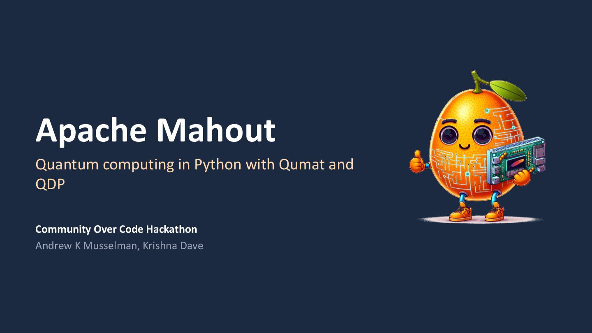

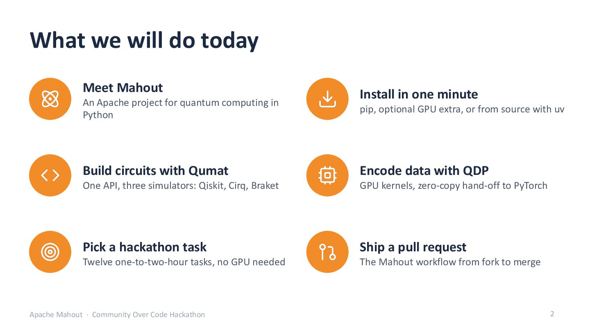

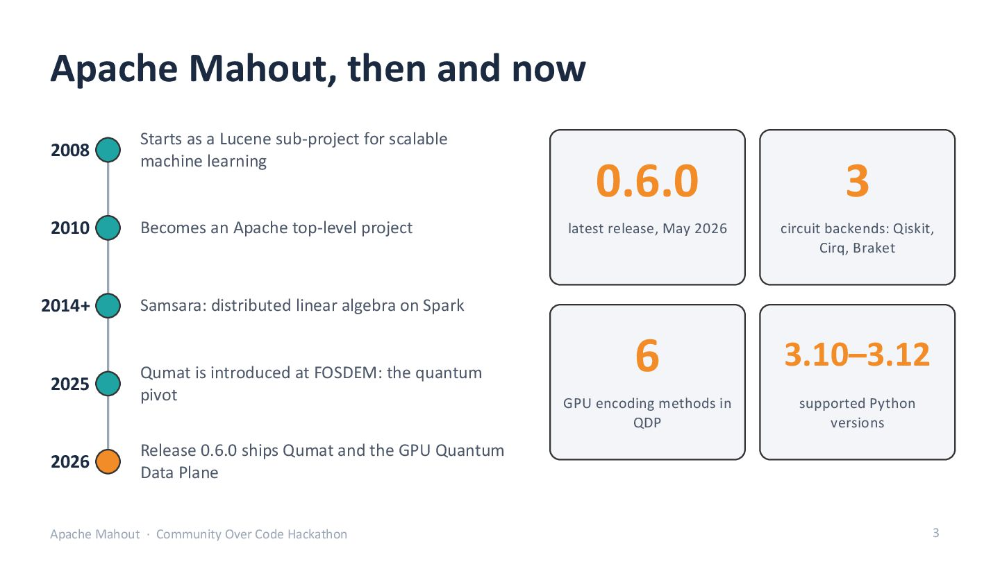

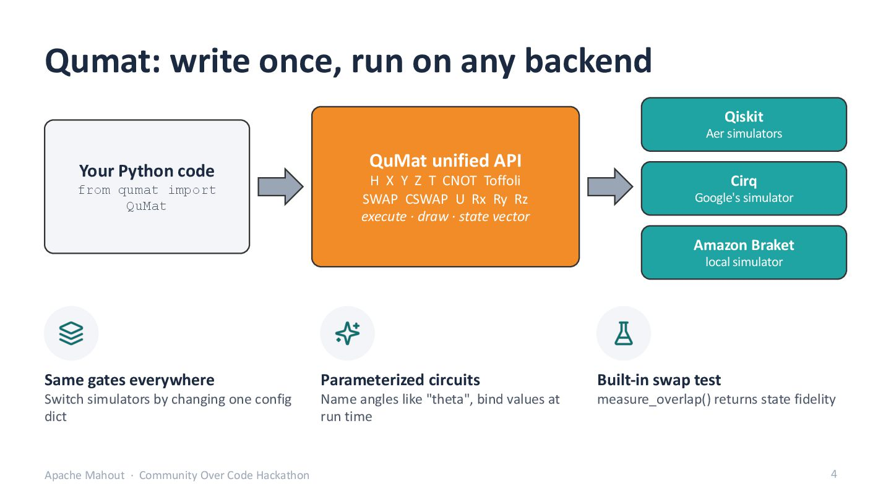

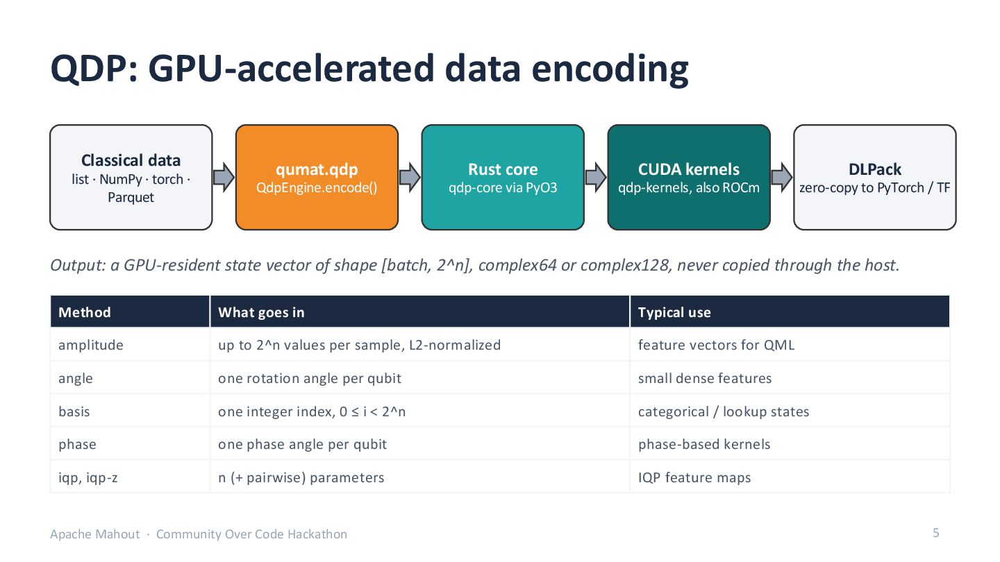

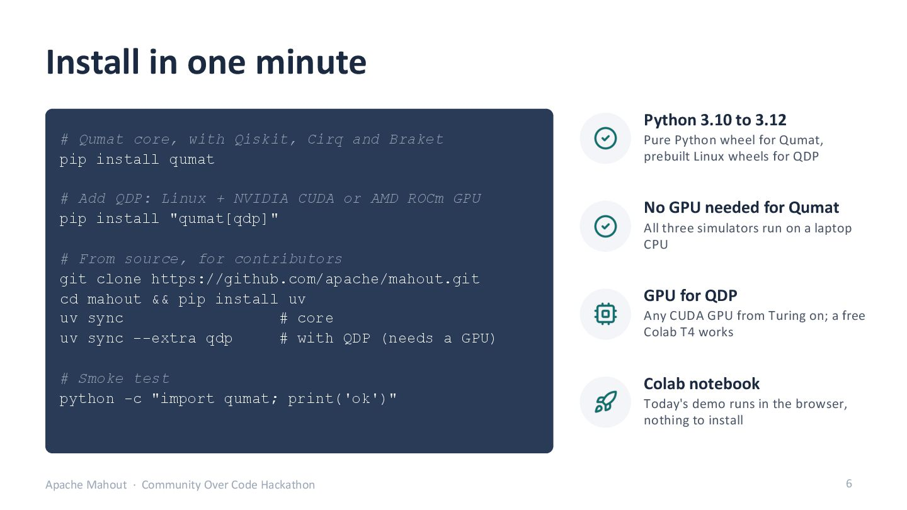

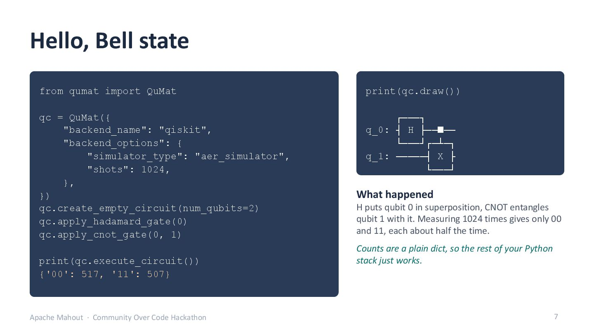

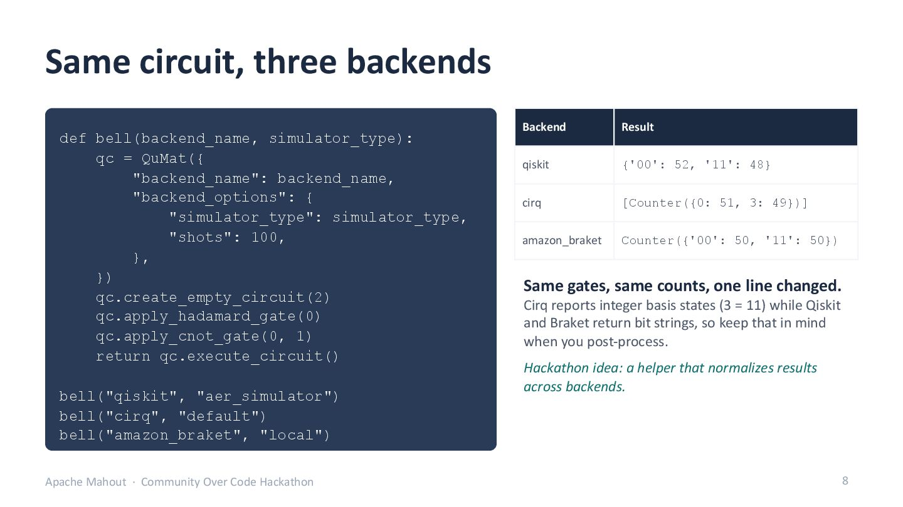

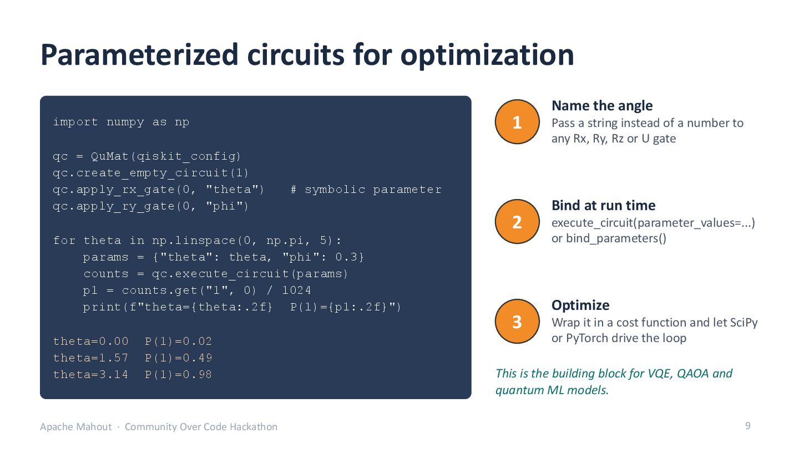

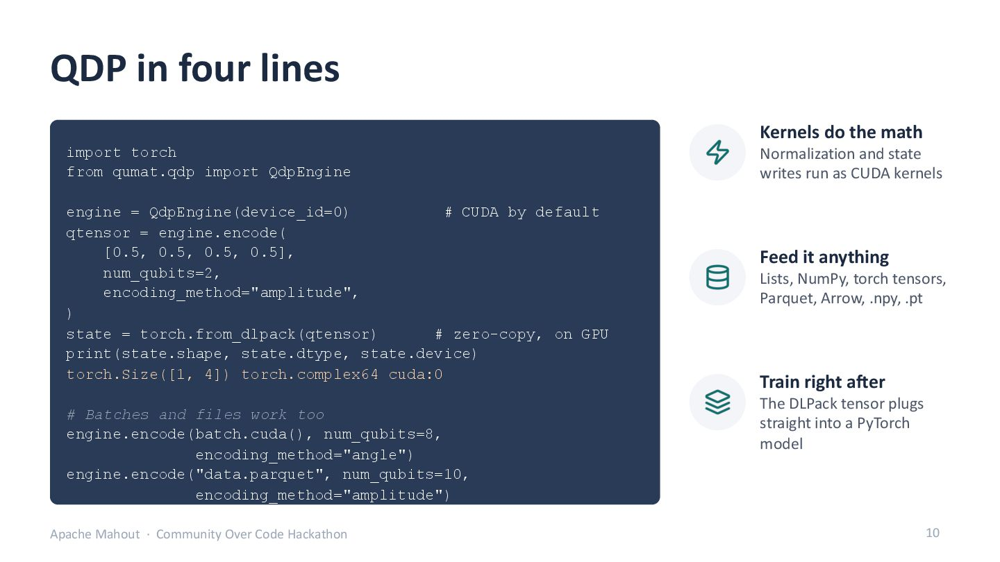

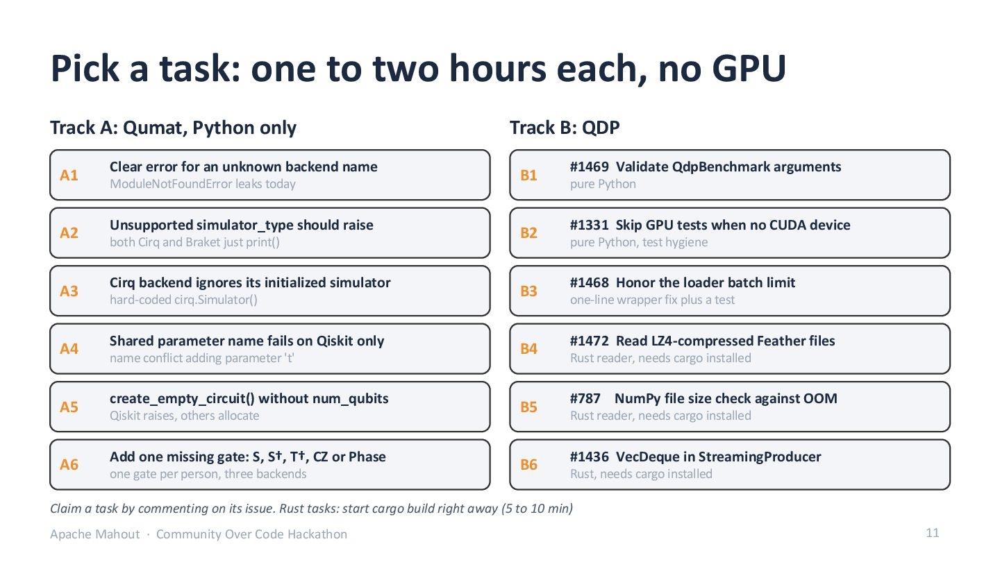

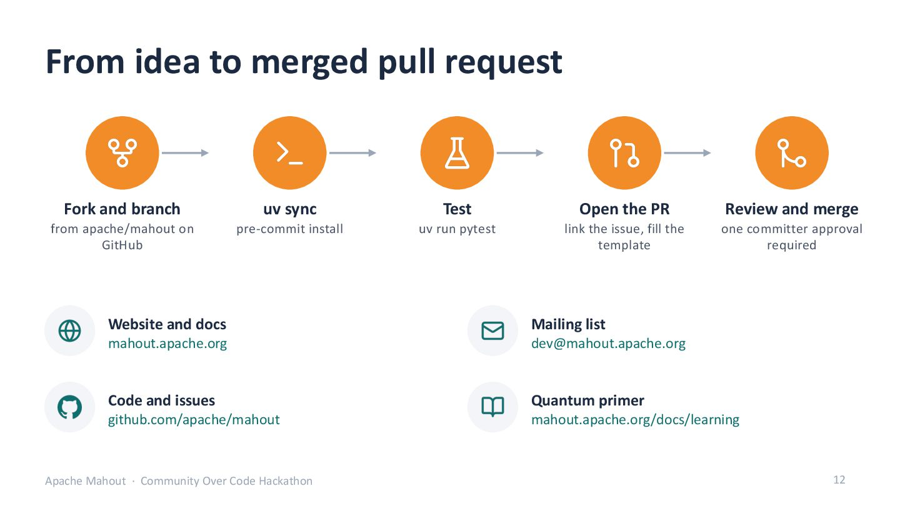

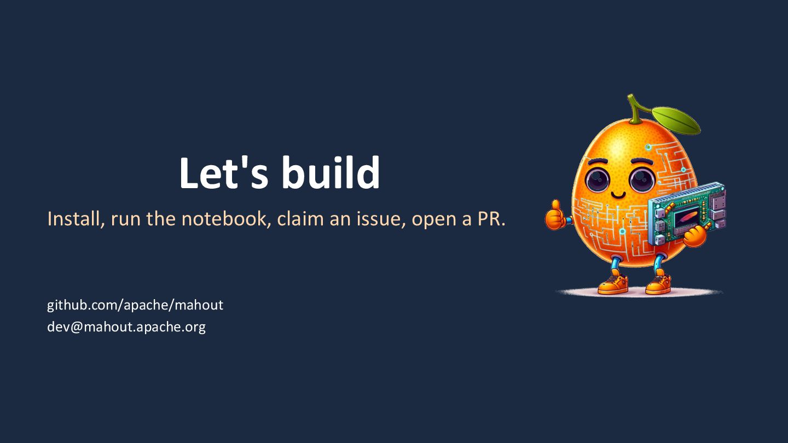

## Hackathon tasks

Every task is sized for one to two hours, needs no GPU, and ends in a pull request with a test. Claim a task by commenting on its issue. Full details, including reproduction steps, are in the [task sheet](pathname:///hackathon/mahout-hackathon-tasks.md).

**Track A: Qumat (Python only).** All reproduced on `main` and on `qumat` 0.6.0. Each issue has the reproduction steps.

| # | Issue | Task |
|---|---|---|
| A1 | [#1506](https://github.com/apache/mahout/issues/1506) | Clear `ValueError` for an unknown backend name (today a `ModuleNotFoundError` leaks) |
| A2 | [#1507](https://github.com/apache/mahout/issues/1507) | Unsupported `simulator_type` should raise instead of `print()` and silently continuing |
| A3 | [#1508](https://github.com/apache/mahout/issues/1508) | Cirq backend ignores the initialized simulator and creates its own `cirq.Simulator()` |
| A4 | [#1509](https://github.com/apache/mahout/issues/1509) | Bug: reusing a parameter name on two gates fails on Qiskit only (`name conflict adding parameter 't'`) |
| A5 | [#1510](https://github.com/apache/mahout/issues/1510) | `create_empty_circuit()` without `num_qubits`: Qiskit raises, Cirq and Braket allocate on demand |
| A6 | [#1511](https://github.com/apache/mahout/issues/1511) | Add **one** missing gate per person: S, S-dagger, T-dagger, CZ or Phase, on all three backends with a test |
| A7 | [#1512](https://github.com/apache/mahout/issues/1512) | Python 3.13 support: lift the `<3.13` cap in `pyproject.toml` and add 3.13 to CI |

**Track B: QDP.** B1 to B3 are pure Python. B4 to B6 are Rust: take one only if `cargo` is already installed, and start the first `cargo build` right away (5 to 10 minutes). No CUDA needed, the build uses stubs like CI does.

| # | Issue | Task |
|---|---|---|
| B1 | [#1469](https://github.com/apache/mahout/issues/1469) | `QdpBenchmark` does not validate builder argument ranges |
| B2 | [#1331](https://github.com/apache/mahout/issues/1331) | QDP tests should skip, not error, when no GPU is present |
| B3 | [#1468](https://github.com/apache/mahout/issues/1468) | File loader ignores the configured batch limit (one-line wrapper fix plus a test) |
| B4 | [#1472](https://github.com/apache/mahout/issues/1472) | Read default LZ4-compressed Feather files (Rust reader) |
| B5 | [#787](https://github.com/apache/mahout/issues/787) | NumPy file size check to prevent OOM (Rust reader) |
| B6 | [#1436](https://github.com/apache/mahout/issues/1436) | `StreamingProducer`: `VecDeque` for O(1) buffer advance (Rust) |

## From idea to merged pull request

Setup takes about a minute in a terminal (not in Colab):

```bash
git clone https://github.com/<you>/mahout.git && cd mahout
pip install uv
uv sync                      # Qumat and the Python QDP package
uv run pre-commit install    # ruff + type checks on every commit
uv run pytest testing/qumat  # smoke test
```

Then: comment on the issue to claim it, branch, make the change with a test, and open a PR that links the issue. One committer approval is required to merge, so ping a mentor in the room. Your PR does not have to be finished by 18:40; mentors will keep reviewing afterwards.

## Getting help

- In the room: ask a mentor.
- Slack: the `#hackathon` channel on [apachecon.slack.com](https://apachecon.slack.com)
- Mailing list: [dev@mahout.apache.org](mailto:dev@mahout.apache.org) (subscribe via dev-subscribe@mahout.apache.org)
- Code and issues: [github.com/apache/mahout](https://github.com/apache/mahout)

Have fun, and thanks for hacking on Apache Mahout!
